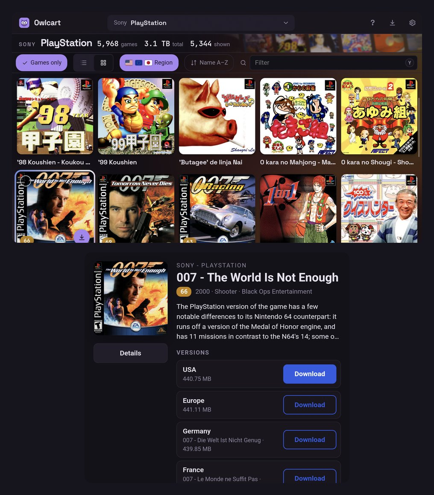
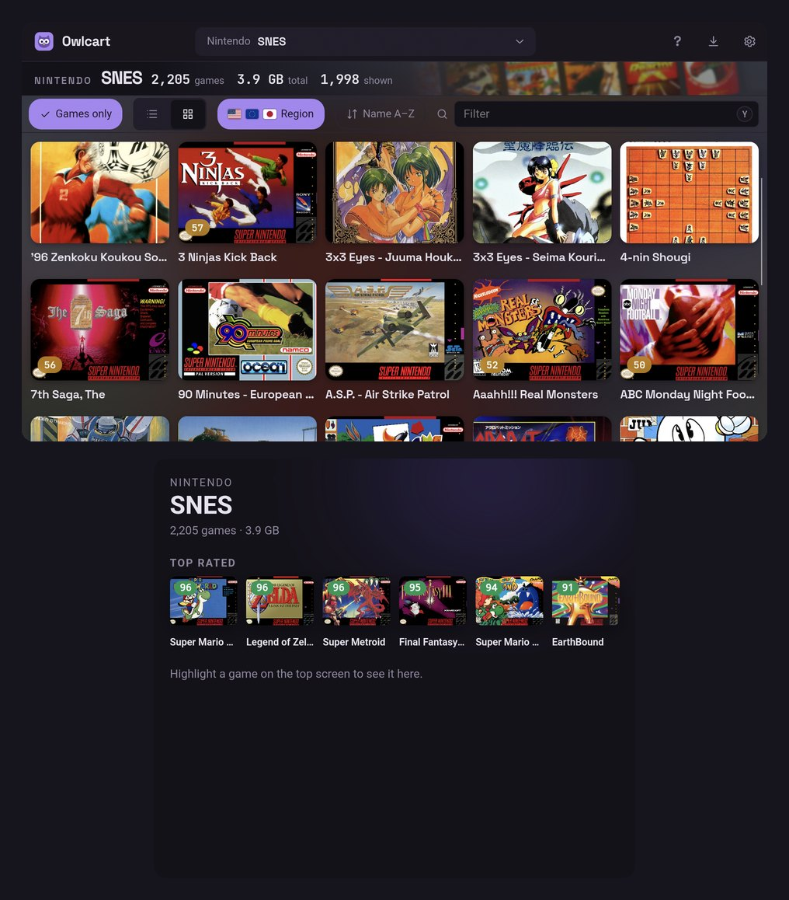
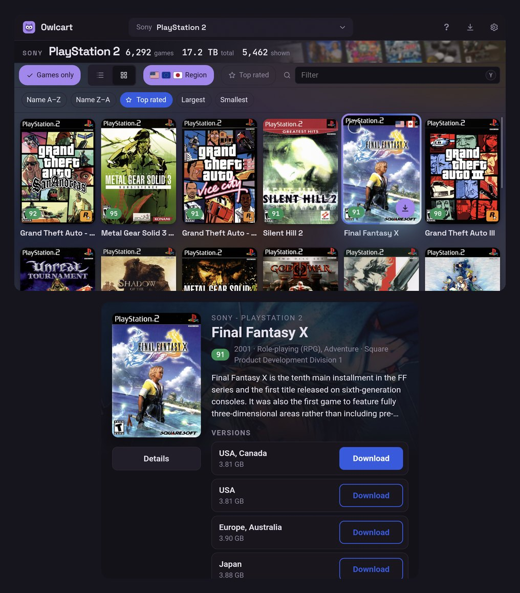
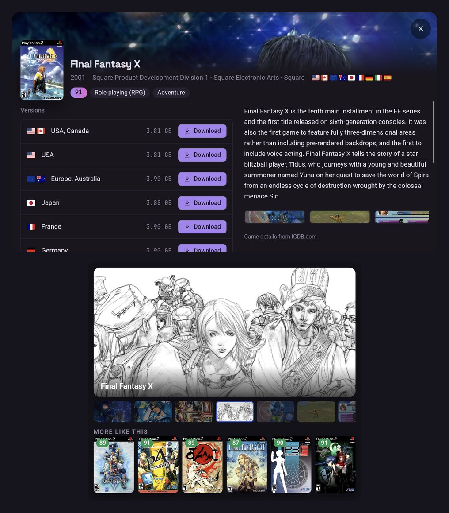

<p align="center">
  
</p>

<h1 align="center">Owlcart</h1>

<p align="center">
  A friendly way to browse the <a href="https://minerva-archive.org">Minerva Archive</a>, see what's worth playing,<br />
  and grab just the games you want, already sorted into the folders your emulator expects.
</p>

<p align="center">
  <a href="../../releases/latest"><b>Download</b></a> ·
  <a href="#features">Features</a> ·
  <a href="#keyboard-shortcuts">Shortcuts</a> ·
  <a href="#controller-buttons">Controller</a> ·
  <a href="#building-from-source">Build</a> ·
  <a href="#game-data">Game data</a>
</p>

<p align="center">
  <a href="../../actions/workflows/release.yml"></a>
</p>

<p align="center">
  <a href="https://www.rust-lang.org"></a>
  <a href="https://v2.tauri.app"></a>
  <a href="https://svelte.dev"></a>
  <a href="https://www.typescriptlang.org"></a>
  <a href="https://vite.dev"></a>
  <a href="https://github.com/ikatson/rqbit"></a>
  <br />
  
  
  
</p>

<p align="center">
  
</p>

---

## Features

Minerva keeps whole console libraries as single torrents, which is great for preservation
and less great when you just want *Suikoden II*. Owlcart puts a proper game browser on top:
pick a console, find the game, press download, and that one game turns up in the right
folder, unzipped and checked.

### Finding something to play

Choose from 43 consoles (<kbd>Ctrl</kbd> <kbd>K</kbd>), then browse as a list or a grid of
cover art. Every game gets one card, however many regions and revisions it came out in, so
*Biohazard 2* and *Resident Evil 2* sit together, and so do *Tomorrow Never Dies* and
*Der Morgen Stirbt Nie*. Your own region's latest version comes first.

You can narrow things down by name or by region. The region filter starts on USA, Europe,
Japan and worldwide releases, and remembers whatever you change it to. *Games only* hides the
demos, betas and prototypes, and sorting by rating puts a console's best games first. Ratings
come from IGDB and take review counts into account, so a game rated 98 by three people doesn't
beat one rated 95 by hundreds.

Open a game for its summary, release date, developer, genres and screenshots, plus every
version side by side. Xbox 360, PS3, 3DS and Wii games also list their updates and DLC.

<p align="center">
  
  <br />
  <sub>Click any game to see its details and every regional version.</sub>
</p>

### Downloading

Owlcart only fetches the file you picked, not the whole multi-hundred-gigabyte console set.
Games land in [ES-DE](https://es-de.org) style folders (`psx`, `gbc`, `n64`…), so ES-DE,
Batocera and friends pick them up straight away. Zips are unpacked and every file is checked
against its checksum. Games you already have are marked, even ones you downloaded before
Owlcart came along, and the downloads button keeps track of progress with pause, resume and
retry.

### On handhelds

Owlcart runs on Android too, and it's at its best on a handheld. The D-pad moves through
games, the face buttons download and search, and <kbd>L2</kbd> <kbd>R2</kbd> flip between
consoles. The on-screen hints switch to your controller's buttons once it's connected.

If you've got a dual-screen device like the AYN Thor, the second screen joins in. Browse on
the top screen and the bottom one shows the highlighted game: its details, its versions and a
slideshow of screenshots. With nothing highlighted, it shows the console's top-rated games
instead. Open a game's details and the bottom screen becomes a screenshot gallery, with a few
games like it underneath in case you're after something similar.

A few smaller touches: covers take the shape of each console's real boxes, so PlayStation
games get square jewel cases and SNES games get wide boxes. Each console has its own colour,
and you can switch on rumble and menu sounds if you like a bit of feedback.

<table align="center">
  <tr>
    <td align="center"><br /><sub>Browse on top, details below. PlayStation's covers are square</sub></td>
    <td align="center"><br /><sub>Nothing highlighted? The console's best. SNES boxes are wide</sub></td>
  </tr>
  <tr>
    <td align="center"><br /><sub>Sorting by rating, in PS2's tall cases</sub></td>
    <td align="center"><br /><sub>Details on top, screenshots and similar games below</sub></td>
  </tr>
</table>

### And the rest

Light and dark themes follow your system, and there are [keyboard shortcuts](#keyboard-shortcuts)
for just about everything. When a new version comes out, a little *update available* button
appears at the top. It takes you to the release (or, on Android, straight to the new APK);
nothing installs itself, and you can turn the check off in Settings. If a console is missing
cover art, you can fetch it yourself from inside the app with free API keys.

## Download

Grab the latest build from [**Releases**](../../releases/latest).

| Platform | File | Notes |
| --- | --- | --- |
| **Windows** | `Owlcart_x.y.z_x64-setup.exe` | The installer isn't code-signed yet, so SmartScreen may warn you the first time. Choose *More info → Run anyway*. |
| **Linux (Debian, Ubuntu)** | `.deb` | |
| **Linux (Fedora, openSUSE)** | `.rpm` | |
| **Linux (anything else)** | `.AppImage` | `chmod +x` it and run. |
| **Android** | `Owlcart_x.y.z_android_arm64.apk` | For 64-bit ARM phones and handhelds. Android will ask you to allow installs from your browser or file manager. |

The BitTorrent engine is built in, so there's nothing else to install.

## Getting started

1. **Pick a console** from the picker at the top (<kbd>Ctrl</kbd> <kbd>K</kbd>).
2. **Find a game.** Type to filter (<kbd>/</kbd>), tap a region flag, or switch to the grid (<kbd>V</kbd>).
3. **Open it** to see its details and versions, then hit **Download**. Want a few? Tick them and use the bar at the bottom.
4. **Keep an eye on things** with the downloads button in the title bar (<kbd>D</kbd>). Finished games end up in `Downloads/Owlcart/<console>/` (on Android, `ROMs/<console>/` on your main storage), already unzipped.

The download folder, extraction, folder names and cover art settings all live in **Settings** (<kbd>Ctrl</kbd> <kbd>,</kbd>).

## Keyboard shortcuts

| Keys | Action |
| --- | --- |
| <kbd>/</kbd> | Filter games |
| <kbd>Ctrl</kbd> <kbd>K</kbd> | Choose a console |
| <kbd>↑</kbd> <kbd>↓</kbd> or <kbd>J</kbd> <kbd>K</kbd> | Move through games (<kbd>←</kbd> <kbd>→</kbd> too in grid view) |
| <kbd>Enter</kbd> | Open game details |
| <kbd>Space</kbd> | Select or deselect |
| <kbd>Ctrl</kbd> <kbd>A</kbd> | Select everything shown |
| <kbd>Ctrl</kbd> <kbd>Enter</kbd> | Download the selection (or the highlighted game) |
| <kbd>V</kbd> | Switch between list and grid |
| <kbd>D</kbd> | Downloads |
| <kbd>Ctrl</kbd> <kbd>,</kbd> | Settings |
| <kbd>Esc</kbd> | Close, then clear the filter, then the selection |
| <kbd>?</kbd> | Show all shortcuts |

On a Mac, use <kbd>⌘</kbd> instead of <kbd>Ctrl</kbd>.

## Controller buttons

On Android, a controller (built in or paired) works like this. Press <kbd>Select</kbd>, or tap
**?** at the top, to see the list in the app.

| Button | Action |
| --- | --- |
| D-pad | Move through games |
| <kbd>A</kbd> | Open game details |
| <kbd>B</kbd> | Back |
| <kbd>X</kbd> | Download the highlighted game (or the selected ones) |
| <kbd>Y</kbd> | Search |
| <kbd>L1</kbd> <kbd>R1</kbd> | Page up / down |
| <kbd>L2</kbd> <kbd>R2</kbd> | Previous / next console |
| <kbd>Start</kbd> | Downloads |
| <kbd>Select</kbd> | Show these buttons |
| <kbd>L3</kbd> | Switch between list and grid |
| <kbd>R3</kbd> | Games only (hide demos, betas and prototypes) |

## How it works

Minerva publishes each console as one big torrent, often hundreds of gigabytes. Here's how
Owlcart gets just one game out of it:

1. It reads the console's listing on minerva-archive.org. Each game's page points to the
   console's `.torrent` and says where the game sits inside it.
2. It downloads the `.torrent` once and caches it, then the built-in BitTorrent engine
   ([librqbit](https://github.com/ikatson/rqbit)) fetches only that one file.
3. The game downloads into a hidden temporary folder. Torrent pieces overlap neighbouring
   files, so a few scraps of those come along too and get thrown away. Then the game is
   moved into its console folder and unzipped.

The engine handles one download per torrent at a time, so games from the same console wait
their turn, while different consoles download side by side.

Listing pages can be several megabytes, so Owlcart asks for them compressed and keeps a copy
of each console it's opened. Next time that console shows straight away, and Owlcart quietly
checks with the server whether anything changed (usually nothing has). On Android, the
consoles either side of the current one are loaded ahead of time too, so flicking through
them with <kbd>L2</kbd> <kbd>R2</kbd> is instant. A side effect is that consoles you've visited
can still be browsed offline.

## Building from source

You'll need [Rust](https://rustup.rs), [Node.js](https://nodejs.org) and the
[Tauri prerequisites](https://v2.tauri.app/start/prerequisites/) for your OS.

```sh
npm install
npm run tauri dev      # run in development
npm run tauri build    # installers end up in src-tauri/target/release/bundle/
```

**Android:** you'll also need the Android SDK and NDK (see Tauri's
[Android prerequisites](https://v2.tauri.app/start/prerequisites/#android)). Then:

```sh
npm run tauri android build -- --apk --target aarch64
```

Release APKs are signed with the key named in `src-tauri/gen/android/keystore.properties`
(`storeFile`, `keyAlias` and `password`; it isn't in git). Without that file the APK comes out
unsigned. Every release has to use the same key, or Android won't install it as an update.

librqbit lives in `src-tauri/vendor/librqbit` with a couple of small changes. Minerva's
torrents are big enough that it needed a larger per-peer read buffer, and on Android it uses
bundled root certificates for HTTPS. `OWLCART-CHANGES.md` in there has the details.

## Game data

Box art comes first from the [libretro thumbnails](https://github.com/libretro-thumbnails/libretro-thumbnails)
collection (the one RetroArch uses). It's sorted by system and named after the same No-Intro
and Redump file names as Minerva, so an Xbox game gets the Xbox box, not the GBA one. Games it
doesn't have fall back to [SteamGridDB](https://www.steamgriddb.com), then
[IGDB](https://www.igdb.com), which also provides the game details. Everything is looked up
ahead of time and saved as plain JSON, so the app itself never needs a key. The `data/`
folder is also packed into each build, so covers and details work straight away, even before
any hosted data is set up.

IGDB is also how regional versions end up on one card. Each title is matched to an IGDB game,
by its name or, for other languages, by the alternative names IGDB keeps (that's how
*Demain ne Meurt Jamais* finds *Tomorrow Never Dies*). Titles with the same IGDB game are
grouped.

```
data/
├── index.json                       consoles, versions and counts
└── <console>/
    ├── covers.json                  title → cover (libretro, then SteamGridDB, then IGDB)
    ├── games.json                   title → IGDB id, rating and review count (for grouping and sorting)
    └── details/00.json … ff.json    IGDB details, split into 256 small files by title hash
```

When you open a console, the app loads its `covers.json` and `games.json`. Details are only
fetched when you open a game, and then just the one small file it lives in. Everything is
cached on disk and only refreshed when that console's `updated` value in `index.json` changes,
so browsing works offline too.

### Fetching data

**In the app:** open a console, then *Settings → Game data*. Add a SteamGridDB key and/or an
IGDB client ID and secret, and click **Fetch art & details**. Set *Save fetched data to* to this
project's `data/` folder if you want to commit the results.

**From the command line:**

1. Put your keys in the project root. Both files are git-ignored.
   - `.steamgriddb-key`: from [SteamGridDB API preferences](https://www.steamgriddb.com/profile/preferences/api)
   - `.igdb-credentials`: `client_id=…` and `client_secret=…` from a *Confidential* app at
     [dev.twitch.tv](https://dev.twitch.tv/console/apps) (redirect URL `http://localhost`)
2. Run one of:

   ```sh
   npm run data -- ps2 saturn    # add consoles (matched by name or slug; "all" for everything)
   npm run data                  # update every console that already has data
   ```

   Running it again only looks up new titles, and your hand edits are kept. A few options:

   - `--retry-missing` has another go at titles that found nothing. It works in quick
     batches and skips demos, betas and BIOS files, so even every console at once takes well
     under an hour.
   - `--refresh-ratings` updates ratings and review counts.
   - `--libretro` swaps existing covers for libretro's wherever it has one.
   - `--verbose` prints every match.

   `npm run data:list` shows what you've got so far.

`consoles.json` lists every console in the picker: its group, name, ES-DE folder, Minerva link,
IGDB platform, libretro thumbnails folder and box shape. It ships inside the app, and consoles
added to the hosted `index.json` later appear without an app update.

### Publishing data

Host the `data/` folder somewhere (GitHub Pages is fine) and set `DEFAULT_DATA_URL` in
`src-tauri/src/jobs.rs`. People can point the app somewhere else in Settings, and a local
folder works too.

## Releases

Push to `main` with a version that hasn't been released yet, and GitHub Actions builds the
Windows, Linux and Android versions and publishes them as a release.

```sh
npm run bump -- patch     # or minor / major / 1.2.3: updates every version field
git commit -am "Release v0.1.1" && git push
```

Releases start as drafts and only go public once every build has succeeded.

## Tests

```sh
cd src-tauri
cargo test

# Hosted data (serve data/ first: python3 -m http.server 8765 -d ../data)
DATA_URL=http://127.0.0.1:8765 cargo test remote -- --ignored --nocapture

# Real downloads and lookups (need network and keys)
TEST_TORRENT=/path/to/console.torrent cargo test e2e -- --ignored --nocapture
cargo test live_fetch -- --ignored --nocapture
```

## Project layout

```
src/                 Svelte UI (routes/+page.svelte, lib/ components)
src-tauri/src/       Rust backend
  jobs.rs            download queue, settings, extraction hand-off
  engine.rs          built-in BitTorrent engine (librqbit)
  scrape.rs          Minerva listing and game page parsing
  data.rs            reading published/fetched game data, with disk cache
  fetch.rs           in-app cover and details fetching
  covers.rs          SteamGridDB lookups and title matching
  extract.rs         safe .zip extraction
  bundled.rs         game data shipped inside the app, unpacked on first run
  second_screen.rs   dual-screen support (Android)
  gamepad.rs         controller detection and rumble (Android)
  folder_picker.rs   choosing a download folder (Android)
src-tauri/gen/android/app/src/main/
  java/dev/owlcart/app/   Kotlin side of the Android plugins, and MainActivity
  assets/second-screen.html   the page shown on a second screen
scripts/             data builder (libretro, SteamGridDB and IGDB lookups) and version bump
data/                published covers and details
consoles.json        consoles shown in the picker
```

## Credits

- Games are hosted by the [Minerva Archive](https://minerva-archive.org) community. Owlcart is an
  independent client and isn't affiliated with Minerva.
- Game details from [IGDB.com](https://www.igdb.com). Box art from the
  [libretro thumbnails](https://github.com/libretro-thumbnails/libretro-thumbnails) project and
  [SteamGridDB](https://www.steamgriddb.com).
- Downloads by [librqbit](https://github.com/ikatson/rqbit) (Apache-2.0). Flags from [flag-icons](https://github.com/lipis/flag-icons).
  Fonts: Space Grotesk and JetBrains Mono.

Please only download games you're entitled to where you live.
