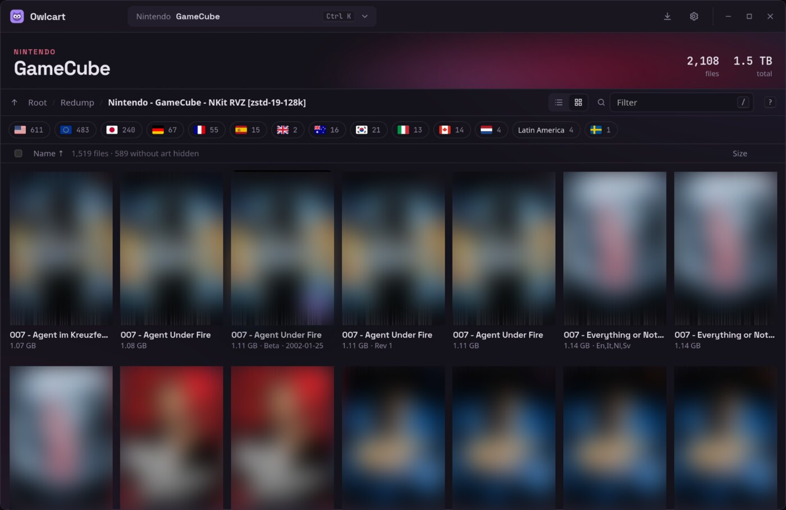
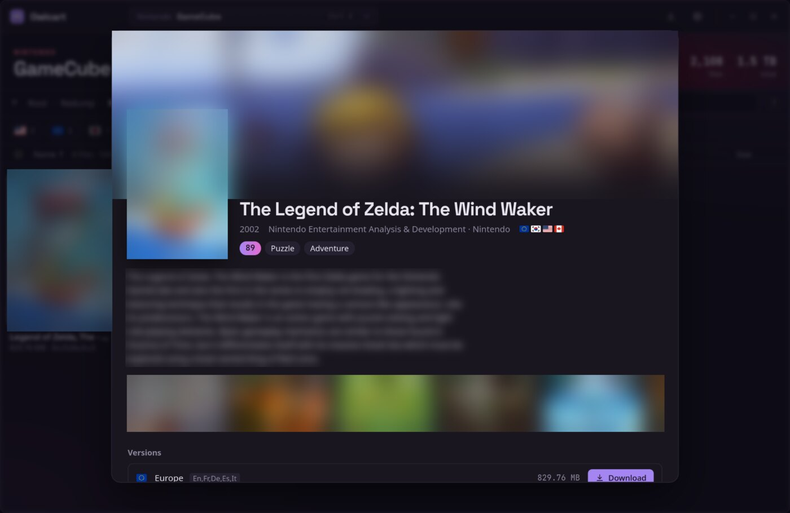

<p align="center">
  
</p>

<h1 align="center">Owlcart</h1>

<p align="center">
  Browse the <a href="https://minerva-archive.org">Minerva Archive</a> by console, see cover art and game details,<br />
  and download just the games you want, straight into folders your emulator front-end understands.
</p>

<p align="center">
  <a href="../../releases/latest"><b>Download</b></a> ·
  <a href="#features">Features</a> ·
  <a href="#keyboard-shortcuts">Shortcuts</a> ·
  <a href="#building-from-source">Build</a> ·
  <a href="#game-data">Game data</a>
</p>

<p align="center">
  <a href="../../actions/workflows/release.yml"></a>
</p>

<p align="center">
  
</p>

---

## Features

**Find games**
- 🎮 **Console picker** with 43 systems across Nintendo, Sega, Sony, Microsoft, NEC, SNK, Atari and more (<kbd>Ctrl</kbd> <kbd>K</kbd>)
- 🖼️ **List or grid view**, with cover art and smooth, animated filtering
- 🌍 **Region filters** shown as flags, with live counts
- 📖 **Game details**: summary, release date, developer, genres, rating and screenshots, plus every regional version side by side

**Download them**
- ⚡ **Single games from huge torrents**: Owlcart fetches only the file you pick, not the whole console set
- 📁 **ES-DE folder names** (`psx`, `gbc`, `n64`, `xbox360`…) so games drop straight into ES-DE, Batocera and similar
- 📦 **Automatic extraction** of `.zip` files, with every file checked against its checksum
- ✅ **Already-downloaded games are marked**, including ones from before you installed Owlcart
- 🔔 **Downloads popover** with progress, speed, pause, resume and retry

<p align="center">
  
  <br />
  <sub>Click any game for its details and every regional version. (Artwork blurred in these screenshots.)</sub>
</p>

**Make it yours**
- 🎨 Light and dark themes that follow your system
- ⌨️ [Keyboard shortcuts](#keyboard-shortcuts) for everything
- 🦉 Fetch cover art and details yourself from inside the app (free API keys)

## Download

Grab the latest build from [**Releases**](../../releases/latest).

| Platform | File | Notes |
| --- | --- | --- |
| **Windows** | `Owlcart_x.y.z_x64-setup.exe` | Includes aria2. The installer isn't code-signed yet, so Windows SmartScreen may warn the first time; choose *More info → Run anyway*. |
| **Linux (Debian, Ubuntu)** | `.deb` | Installs the `aria2` dependency for you. |
| **Linux (Fedora, openSUSE)** | `.rpm` | Installs the `aria2` dependency for you. |
| **Linux (anything else)** | `.AppImage` | Install your distro's `aria2` package first, then `chmod +x` and run. |

## Getting started

1. **Pick a console** from the picker at the top (<kbd>Ctrl</kbd> <kbd>K</kbd>).
2. **Find a game**: filter by name (<kbd>/</kbd>), tap region flags, or switch to grid view (<kbd>V</kbd>).
3. **Click a game** to see its details and every version, then hit **Download**. To grab several at once, tick them and use the selection bar.
4. Watch progress from the **download button** in the title bar (<kbd>D</kbd>). Finished games land in `Downloads/Owlcart/<console>/`, already unzipped.

Everything else, including the download folder, extraction, folder naming and cover art, is in **Settings** (<kbd>Ctrl</kbd> <kbd>,</kbd>).

## Keyboard shortcuts

| Keys | Action |
| --- | --- |
| <kbd>/</kbd> | Filter games |
| <kbd>Ctrl</kbd> <kbd>K</kbd> | Choose a console |
| <kbd>↑</kbd> <kbd>↓</kbd> or <kbd>J</kbd> <kbd>K</kbd> | Move through games (<kbd>←</kbd> <kbd>→</kbd> too in grid view) |
| <kbd>Enter</kbd> | Open game details |
| <kbd>Space</kbd> | Select or deselect |
| <kbd>Ctrl</kbd> <kbd>A</kbd> | Select everything shown |
| <kbd>Ctrl</kbd> <kbd>Enter</kbd> | Download the selection (or the highlighted game) |
| <kbd>V</kbd> | Switch between list and grid |
| <kbd>D</kbd> | Downloads |
| <kbd>Ctrl</kbd> <kbd>,</kbd> | Settings |
| <kbd>Esc</kbd> | Close, then clear the filter, then the selection |
| <kbd>?</kbd> | Show all shortcuts |

On macOS, use <kbd>⌘</kbd> instead of <kbd>Ctrl</kbd>.

## How it works

Minerva publishes each console as one large torrent, often hundreds of gigabytes. Owlcart
downloads only the game you choose:

1. It reads the console's listing on minerva-archive.org. Each game's page gives the
   console's `.torrent` and the game's position inside it.
2. The `.torrent` is downloaded once and cached. A private [aria2](https://aria2.github.io/)
   instance, driven over JSON-RPC, fetches just that one file (`--select-file`).
3. The game downloads into a hidden temporary folder. Torrent pieces overlap neighbouring
   files, so aria2 writes small fragments of those too, and they're thrown away. Then the
   game is moved into its console folder and unzipped.

aria2 handles one download per torrent at a time, so games from the same console queue up,
while different consoles download in parallel.

## Building from source

You'll need [Rust](https://rustup.rs), [Node.js](https://nodejs.org) and the
[Tauri prerequisites](https://v2.tauri.app/start/prerequisites/) for your OS.

```sh
npm install
npm run tauri dev      # run in development
npm run tauri build    # installers end up in src-tauri/target/release/bundle/
```

**aria2c**
- **Windows:** `scripts/fetch-aria2c.ps1` runs automatically before dev and build. It
  downloads the official static `aria2c.exe` and bundles it with the app.
- **Linux:** install your distro's `aria2` package. The `.deb` and `.rpm` declare it as a dependency.
- Set `OWLCART_ARIA2C=/path/to/aria2c` to use a specific binary.

## Game data

Cover art and game details come from [SteamGridDB](https://www.steamgriddb.com) and
[IGDB](https://www.igdb.com). They're looked up once with your own free API keys and saved as
static JSON, so the app never ships with a key.

```
data/
├── index.json                       consoles, versions and counts
└── <console>/
    ├── covers.json                  title → cover (SteamGridDB, with IGDB as a fallback)
    └── details/00.json … ff.json    IGDB details, split into 256 small files by title hash
```

The app loads a console's `covers.json` when you open it, and only the one small details file
a game needs when you open its details. Downloads are cached on disk and only refreshed when
that console's `updated` value in `index.json` changes, so browsing also works offline.

### Fetching data

**In the app:** open a console, then *Settings → Game data*. Add a SteamGridDB key and/or an
IGDB client ID and secret, and click **Fetch art & details**. Set *Save fetched data to* to this
project's `data/` folder if you want to commit the results.

**From the command line:**

1. Put your keys in the project root. Both files are git-ignored.
   - `.steamgriddb-key`: from [SteamGridDB API preferences](https://www.steamgriddb.com/profile/preferences/api)
   - `.igdb-credentials`: `client_id=…` and `client_secret=…` from a *Confidential* app at
     [dev.twitch.tv](https://dev.twitch.tv/console/apps) (redirect URL `http://localhost`)
2. Run one of:

   ```sh
   npm run data -- ps2 saturn    # add consoles (matched by name or slug; "all" for everything)
   npm run data                  # update every console that already has data
   ```

   Re-runs only look up new titles and keep hand edits. `--retry-missing` retries titles that
   found nothing, and `--verbose` prints each match.

`consoles.json` lists every console in the picker (group, name, ES-DE folder, Minerva link, IGDB
platform). It ships inside the app, and consoles added to the hosted `index.json` later appear
without an app update.

### Publishing data

Host the `data/` folder (GitHub Pages works well) and set `DEFAULT_DATA_URL` in
`src-tauri/src/jobs.rs`. Users can override it in Settings, and a local folder works too.

## Releases

Pushing to `main` with a version that hasn't been released yet builds Windows and Linux
installers on GitHub Actions and publishes them as a release.

```sh
npm run bump -- patch     # or minor / major / 1.2.3: updates every version field
git commit -am "Release v0.1.1" && git push
```

Releases start as drafts and are only published once both builds succeed.

## Tests

```sh
cd src-tauri
cargo test

# Hosted data (serve data/ first: python3 -m http.server 8765 -d ../data)
DATA_URL=http://127.0.0.1:8765 cargo test remote -- --ignored --nocapture

# Real downloads and lookups (need network and keys)
TEST_TORRENT=/path/to/console.torrent cargo test e2e -- --ignored --nocapture
cargo test live_fetch -- --ignored --nocapture
```

## Project layout

```
src/                 Svelte UI (routes/+page.svelte, lib/ components)
src-tauri/src/       Rust backend
  jobs.rs            download queue, settings, extraction hand-off
  aria2.rs           private aria2c instance over JSON-RPC
  scrape.rs          Minerva listing and game page parsing
  data.rs            reading published/fetched game data, with disk cache
  fetch.rs           in-app cover and details fetching
  covers.rs          SteamGridDB lookups and title matching
  extract.rs         safe .zip extraction
scripts/             data builder, version bump, aria2c download for Windows
data/                published covers and details
consoles.json        consoles shown in the picker
```

## Credits

- Games are hosted by the [Minerva Archive](https://minerva-archive.org) community. Owlcart is an
  independent client and isn't affiliated with Minerva.
- Game details from [IGDB.com](https://www.igdb.com). Cover art from [SteamGridDB](https://www.steamgriddb.com).
- Downloads by [aria2](https://aria2.github.io/). Flags from [flag-icons](https://github.com/lipis/flag-icons).
  Fonts: Space Grotesk and JetBrains Mono.

Only download games you're entitled to under the laws where you live.
